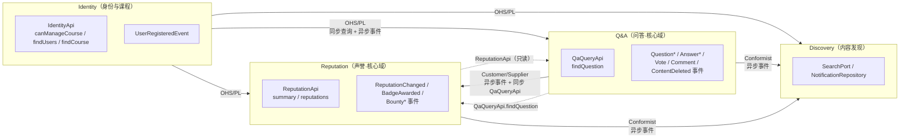

# 上下文映射（Context Map）

> 产出：Sprint 0 事件风暴工作坊｜依据：指导书 3.1 / 3.2 / ADR-001
> 维护：PO 与各上下文主责人共同 review；边界调整必须走 ADR。

## 1. 子域与限界上下文

| 子域 | 类型 | 限界上下文 | 判断依据 | 主责人 |
| :-- | :-- | :-- | :-- | :-- |
| 课程问答 | **核心域** | Q&A（`co-qa`） | 平台存在的理由；“只能采纳一次”“已删除不可回答”等规则最复杂、最体现差异化 | 宾艺涵 @XY1897 |
| 激励与声誉 | **核心域** | Reputation（`co-reputation`） | 决定社区能否持续活跃；账本、悬赏、反作弊是本校定制的“游戏规则” | 陈阳 @yttt697 |
| 身份与课程 | 支撑子域 | Identity（`co-identity`） | 必要但不独特；校园身份认证与课程成员关系是授权依据 | 韦国超 @jingmo2233 |
| 内容发现 | 通用/支撑子域 | Discovery（`co-discovery`） | 搜索、推荐、通知是通用能力，可替换为 Elasticsearch 或独立服务（ADR-001 第一拆分候选） | 陈阳 @yttt697 |

## 2. 上下文映射图

> 实线 = 主要集成方向（上游 → 下游）；虚线 = 只读的同步查询。橙色（异步）与蓝色（同步）在答辩 PPT 中用颜色区分。

## 3. 关系明细

| 上游 → 下游 | 关系模式 | 集成方式 | 说明 |
| :-- | :-- | :-- | :-- |
| Identity → Q&A / Reputation / Discovery | 开放主机服务 + 发布语言（OHS/PL） | 同步 `IdentityApi`；异步 `UserRegisteredEvent` | 下游只拿到 `UserSummary`（不含学号、邮箱等个人信息） |
| Q&A → Reputation | 客户/供应商（Customer/Supplier） | 异步：`Answer*` / `VoteCast` 事件；同步：`QaQueryApi.findQuestion` | Reputation 需要的事件字段（如 `questionAuthorId`）由 Q&A 在事件中提供，不允许反向查库 |
| Q&A → Discovery | 遵奉者（Conformist） | 异步：`Question*` / `Answer*` / `Vote*` / `CommentPosted` / `ContentDeleted` | Discovery 把事件折叠为自己的 `SearchDocument` 投影 |
| Reputation → Discovery | 遵奉者（Conformist） | 异步：`Bounty*` / `BadgeAwarded` / `ReputationChanged` | 用于“悬赏中”筛选、悬赏与徽章通知、排行榜 ZSET |
| 全部上下文 | 共享内核（Shared Kernel） | Maven 依赖 `co-shared-kernel` | 修改共享内核须全组评审（影响所有上下文） |

## 4. 集成硬约束（ArchUnit 会拦）

| 编号 | 约束 | 违反表现 |
| :-- | :-- | :-- |
| FF-2 | 一个上下文只能依赖其他上下文的 `*-api` 包 | Reputation 直接 `import com.campusoverflow.qa.domain.Question` |
| FF-3 | 上下文之间无循环依赖 | Q&A 反过来依赖 Reputation 的 api |
| FF-5 | `*-api` 只依赖 JDK 与共享内核 | 事件 record 里引用领域类型或 Spring 类型 |
| FF-6 | JPA 实体位于 `infrastructure`，表名带本上下文前缀（`id_/qa_/rep_/dis_`） | 新建表忘记前缀；实体放进 domain 包 |

## 5. 跨上下文通信的三种合法方式

1. **同步查询**：调用对方 `*Api`（如 `identity.canManageCourse(userId, courseId)`），只读、无副作用。
2. **集成事件**：在**本地事务内**写入 `outbox_event`，由 `OutboxRelay` 投递（见 [events.md](events.md)）。事件是唯一允许的“写”方向通知。
3. **共享内核**：只放与业务无关的通用机制（异常、`Guard`、`Actor`、分页、`EventIds`），不放任何上下文的领域概念。

**禁止**：跨上下文直接注入对方的 Repository、直接查对方的表、通过共享内核传递领域对象。

## 6. 演进路径（ADR-001）

| 阶段 | 动作 | 触发条件 |
| :-- | :-- | :-- |
| 现在 | 模块化单体：一个部署单元，四个上下文物理分包 | 团队 5 人、8 周 |
| 中期 | Discovery 拆为独立服务（`SearchPort` 已隔离，可换 Elasticsearch） | 搜索 QPS 或索引规模成为瓶颈 |
| 长期 | Reputation 独立（事件驱动、账本自洽） | 需要独立扩缩容或跨校共享激励规则 |

## 7. 评审

“我们是一个模块化单体，四个限界上下文物理分包，ArchUnit 守住边界：跨上下文只能走 `*-api` 或集成事件。Q&A 是核心域也是事件源头，Reputation 按 Customer/Supplier 消费它的事件，Discovery 是 Conformist 把事件折叠成自己的搜索投影。共享内核只放异常、Actor、事件契约这类通用机制，改它要两人评审。”
