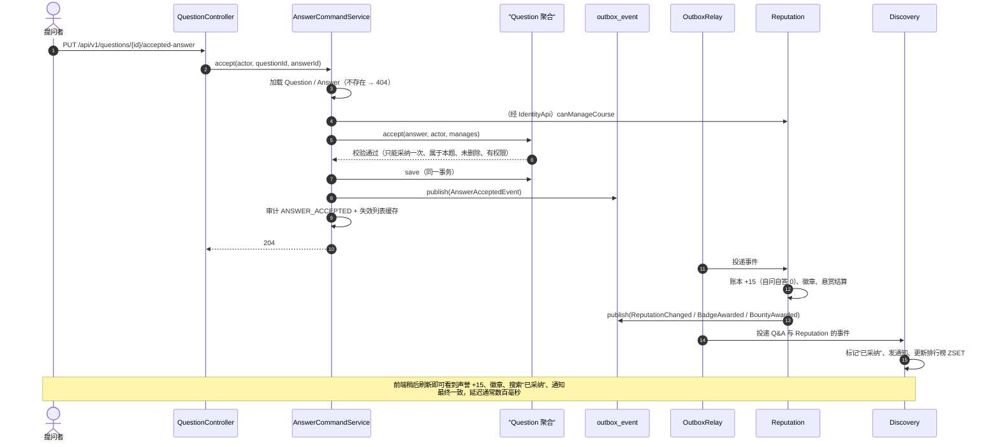

# 领域事件目录（Domain Events）

> 依据：指导书 3.5 / 2.5.1 / ADR-002｜事件契约位置：各上下文 `*-api` 模块
> 约定：事件命名用**过去时**；每个事件必须有全局唯一的 `eventId` 与 `occurredAt`。

## 1. 事件目录

| 事件 | 发布者（触发用例） | 订阅者及处理 | 消费端幂等键 |
| :-- | :-- | :-- | :-- |
| `UserRegisteredEvent` | Identity：注册 / 创建教职工 | Reputation：开立声誉账户并按角色发放初始悬赏积分 | 账户存在即忽略（`(user_id)` 主键） |
| `QuestionPostedEvent` | Q&A：发布问题（`QuestionCommandService.post`） | Discovery：插入搜索投影（含 `plainText`） | `processed_event(eventId, "discovery.search")` |
| `QuestionEditedEvent` | Q&A：编辑问题 | Discovery：更新投影文本与标签 | 同上 |
| `AnswerSubmittedEvent` | Q&A：提交回答 | Reputation：授予“初来乍到”；Discovery：回答数 +1、通知提问者 | 账本 `(event_id, user_id, reason)`；投影 `processed_event`；通知 `(source_event_id, recipient_id)` |
| `AnswerAcceptedEvent` | Q&A：采纳 | Reputation：+15、徽章、悬赏结算；Discovery：标记已采纳、通知回答者 | 同上 |
| `AnswerEndorsedEvent` | Q&A：教师认证 | Reputation：授予“名师认可”；Discovery：通知回答者 | 同上 |
| `VoteCastEvent`（含 `oldValue` / `newValue`） | Q&A：投票 / 改投 / 撤销 | Reputation：按差值计分（受每日上限约束）；Discovery：问题得分同步 | 账本 `(event_id, user_id, reason)` |
| `CommentPostedEvent`（含正文） | Q&A：评论 | Discovery：解析 @ 提及并通知 | 通知 `(source_event_id, recipient_id)` |
| `ContentDeletedEvent(targetType, targetId, questionId)` | Q&A：软删除问题 / 回答 | Discovery：标记投影删除 / 回答数 −1 | `processed_event` |
| `ReputationChangedEvent` | Reputation：记账 | Reputation 内部：排行榜更新周/月/学期 ZSET | `processed_event(eventId, "reputation.leaderboard")` |
| `BadgeAwardedEvent(code, displayName)` | Reputation：授予徽章 | Discovery：通知获得者 | 通知 `(source_event_id, recipient_id)` |
| `BountyOpenedEvent` / `BountyAwardedEvent` / `BountyClosedEvent` | Reputation：悬赏发起 / 结算 / 关闭 | Discovery：维护“悬赏中”标记；`BountyAwarded` 通知获奖者 | `processed_event` / 通知唯一键 |

## 2. 投递机制（事务性发件箱）

```
应用服务（同一本地事务）
   ├─ 保存聚合
   └─ IntegrationEventPublisher.publish(event) → INSERT outbox_event (JSON)
                                  ↓
OutboxRelay（每 500 ms）
   ├─ SELECT … FOR UPDATE SKIP LOCKED + 租约认领
   ├─ 按 id 顺序分发到 Spring 进程内事件总线
   ├─ 任一监听器抛异常 → 本条记为失败、指数退避重试、**停止本批后续事件（保序）**
   └─ 超过 10 次 → 死信（指标 co_outbox_dead_letters）
```

由此得到三条开发纪律：

1. `events.publish(...)` 必须在 `@Transactional` 内、**保存聚合之后**调用；
2. 消费端必须**幂等**（至少一次投递）；
3. 任何一个监听器抛异常都会“堵住”整条发件箱 —— 未进入当前 Sprint 的监听器必须先用**行走骨架**（空实现 + 指向 tech-debt Issue 的注释）占位。

## 3. 重放与排错

```sql
-- 让某条事件重新投递（消费端幂等保证安全）
UPDATE outbox_event SET published_at = NULL, attempts = 0, locked_until = NULL
WHERE event_id = '...';

-- 看积压与死信
SELECT count(*) FROM outbox_event WHERE published_at IS NULL;
SELECT event_id, last_error FROM outbox_event WHERE attempts >= 10;
```

演示“事件重放幂等”时的推荐做法：把一条 `AnswerAcceptedEvent` 置空 `published_at` 重投，展示声誉仍为 15、徽章不重复、悬赏不重复结算。

## 4. 时序：场景 R-2「采纳最佳答案」



## 5. 事件字段约定

| 字段 | 类型 | 说明 |
| :-- | :-- | :-- |
| `eventId` | `String` | 全局唯一（`EventIds.next()`），消费者据此去重 |
| `occurredAt` | `Instant`（UTC） | 由应用服务注入的 `Clock` 提供，便于测试 |
| 业务字段 | 值类型 | 只放**下游需要的**最小信息（如 `questionAuthorId`、`answerAuthorId`），不放整个聚合 |
| 版本 | — | 破坏性变更必须新增事件类型，不允许原地改字段语义（ADR-007 契约优先） |

## 6. 自查清单（PR 评审用）

- [ ] 新事件是否放在 `*-api` 且只依赖 JDK + 共享内核（FF-5）
- [ ] `publish` 是否在事务内、保存之后
- [ ] 每个 `@EventListener` 是否先做幂等判断（`processed_event` / 唯一键 / 存在即忽略）
- [ ] 事件字段是否够下游用（否则下游会反向查库，破坏边界）
- [ ] 是否有对应的集成测试断言“同一事件处理两次不重复生效”
