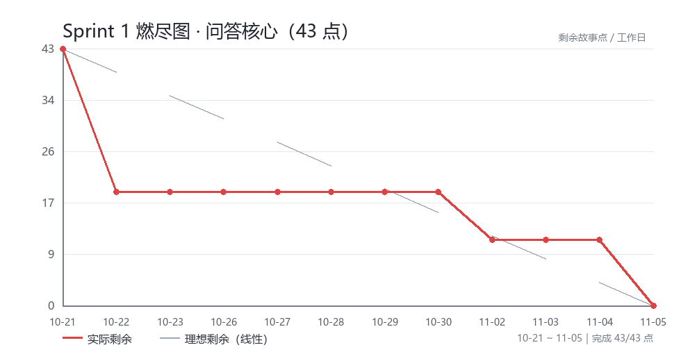

# Sprint 1（2026-10-23 ~ 2026-11-05）· 问答核心

> Sprint 类型：开发冲刺（2 周）｜SM：宾艺涵（@XY1897）｜PO：韦国超（@jingmo2233）
> 版本标签：`v0.2.0`（提交 `1399c10`，2026-11-05）｜评审日期：2026-11-05

## 1. Sprint Goal

学生可以在前端完成“提问 → 回答 → 投票 → 评论 → 采纳”的完整问答闭环，教师可以认证与删除内容；Q&A 领域测试与应用层测试全部通过。

## 2. 计划：纳入的 PBI 与故事点

| PBI | 故事（摘要） | 优先级 | SP | 负责人 | 计划完成 |
| :-- | :-- | :-- | --: | :-- | :-- |
| PB-06 | 发布带标签、可关联课程的问题 | Must | 5 | 宾艺涵（A） | 10-24 |
| PB-07 | 分页浏览问题列表 | Must | 3 | 宾艺涵（A） | 10-26 |
| PB-08 | 问题详情（正文/回答/评论/我的投票/可用操作） | Must | 5 | 宾艺涵（A） | 10-28 |
| PB-09 | 回答未删除的问题 | Must | 3 | 韦国超（B） | 10-25 |
| PB-10 | 采纳最佳答案 | Must | 5 | 韦国超（B） | 10-28 |
| PB-11 | 投票 / 改投 / 撤销 | Must | 5 | 陈阳（C） | 10-29 |
| PB-12 | 编辑问题与回答 | Must | 3 | 宾艺涵（A） | 10-30 |
| PB-13 | 软删除问题与回答 | Must | 3 | 韦国超（B） | 10-30 |
| PB-14 | 教师认证 | Should | 2 | 韦国超（B） | 10-30 |
| PB-15 | 评论与一层回复 | Must | 3 | 陈阳（C） | 10-31 |
| PB-16 | 热门标签 | Should | 1 | 宾艺涵（A） | 10-30 |
| PB-17 | `QaQueryApi.findQuestion` | Must | 1 | 冯先顺（E） | 10-31 |
| PB-18 | 行走骨架（监听器空实现） | Must | 1 | 冯先顺（E） | 10-24 |
| PB-19 | 前端编辑/删除/评论与错误提示 | Should | 3 | 张博（D） | 11-03 |

- **承诺点数**：43 SP（14 条 PBI）
- **容量估算**：5 人 × 2 周 × 8~10 h ≈ 80~100 理想小时，按 80% 承诺 ≈ 64~80 h

## 3. 站会摘要（按提交记录补录）

| 日期 | 昨日完成 | 今日计划 | 阻碍 / 处理 |
| :-- | :-- | :-- | :-- |
| 10-22 | 领域层 18 个方法（`314cdf6`）、应用层用例编排与查询（`7e0cbd3`） | 补构造器校验、错误码拆分、鉴权顺序（评审 P1/P2，`957f2ac`） | 无 |
| 10-26 | 前端课程页与提问入口 | Q&A 应用层测试、读模型缓存 | 部分成员 Docker 未就绪 |
| 10-31 | 投票/评论边界测试（`3078845`）、`CommentServiceTest` 与 `InMemoryComments`（`251344a`） | 补写 `QuestionCommandServiceTest` | 网络不稳定，PR 滞留本地 |
| 11-05 | 三个测试 PR 合入（#3、#4、#7）、回顾与发布说明（#8） | 评审会与 `v0.2.0` | — |

## 4. 评审：演示结果与被接受/退回的 PBI

- **演示路径**：注册 → 登录 → 提问（标题 ≥10 字、2 个标签）→ 列表出现 → 详情 → 回答 → 投票 → 评论 → 采纳 → 教师认证 → 删除。
- **结论**：PB-06 ~ PB-19 **全部接受**（14/14，43 点），无退回。
- **遗留缺陷**：已软删除内容的错误码使用 `QA-1008`（422），与指导书 3.7 建议的 `QA-1020` 字面不同 → 已定案，见 [ADR-010](../adr/010-已删除内容的错误码.md)。
- **教师反馈**：待补录（评审会现场要点，至少 2 条）

## 5. 数据

| 指标 | 数值 | 来源 |
| :-- | :-- | :-- |
| 计划 / 完成点数 | 43 / 43 | 本节 §4 |
| 速度（Velocity） | **43 点**（首个开发冲刺的基准速度） | 本节 |
| 燃尽图 |  ｜ 数据 [burndown/sprint-1.csv](burndown/sprint-1.csv) | 本目录 |
| 合并 PR 数 | 6（#1、#2、#3、#4、#7、#8） | GitHub API（`merged_at` 在本窗口） |
| PR 平均周转 | 44.5 h（≈1.9 天；中位 0.5 h；#3/#4 因网络与分支积压滞留 4.6 天） | PR 时间戳 |
| 提交数（10-23 ~ 11-05） | 60 | `git log --date=short` |
| CI 运行 / 红灯 | 18 次 / 4 次失败（22%） | Actions |
| 新增测试 | 领域层 + 应用层共 55+ 个用例，`co-qa-domain` 覆盖率 ≥ 70% | JaCoCo |
| 版本标签 | `v0.2.0` → `1399c10` | `git tag -n` |

### 5.1 燃尽数据

| 日期 | 剩余点数 | 当日完成 | 说明 |
| :-- | --: | --: | :-- |
| 10-22 | 19 | 24 | PB-07/08/09/10/14/16/17/18/19 的 DoD 关闭 |
| 10-23 | 19 | 0 | — |
| 10-26 | 19 | 0 | — |
| 10-27 | 19 | 0 | — |
| 10-28 | 19 | 0 | — |
| 10-29 | 19 | 0 | — |
| 10-30 | 19 | 0 | — |
| 11-02 | 11 | 8 | PB-11/15 的边界测试于 10-31 合入，按工作日计入 |
| 11-03 | 11 | 0 | — |
| 11-04 | 11 | 0 | — |
| 11-05 | 0 | 11 | PB-06/12/13 的 `QuestionCommandServiceTest` 合入（#7），评审会确认 |

### 5.2 偏差说明（评审时主动解释）

1. **增量集中在 10-22 完成**：Q&A 领域层与应用层在 `314cdf6`、`7e0cbd3` 两个提交中一次落地（08:57–10:20），因此燃尽图首日即下降 24 点，后续几天主要在补测试与评审，曲线呈阶梯而非平滑下降。
2. **故事完成日以 DoD 关闭为准**：`PB-11/15` 的边界测试到 10-31 才补齐、`PB-06/12/13` 的应用层测试到 11-05 才合入，所以这 5 条故事计在对应日期完成，而不是代码写完的 10-22。

## 6. 回顾

- **做得好的**：
  1. 领域规则全部落在聚合与值对象内（无贫血模型）；
  2. 鉴权顺序在评审后修正为先鉴权、再校验归属（避免探测资源归属）；
  3. 应用层测试用 `InMemoryComments` 等手写替身，秒级反馈；
  4. 测试是**加**出来的：27 → 30 个测试文件，未修改任何既有断言。
- **待改进**：
  1. 分支积压（T1-06/T1-09 完成后未及时提 PR）；
  2. 网络不稳定导致推送滞后；
  3. 燃尽曲线呈“阶梯”而非逐日下降，容易被误读为“最后一天赶工”。
- **改进行动**：

| 行动 | 负责人 | 截止 | 跟踪 Issue | 结果 |
| :-- | :-- | :-- | :-- | :-- |
| 任务完成当天即提 PR，分支生命周期 ≤ 3 天 | 全员 | S2 起 | — | 🟡 S2 仍有 11-12 单日 61 提交 |
| 准备备用网络（热点/代理），保证每日至少一次推送 | 全员 | S2 第 1 周 | — | ✅ 已恢复 |
| 统一“已软删除”的错误码并更新 `docs/错误码.md` | PO | S2 计划会 | — | ✅ 见 ADR-010 |
| 补 Sprint 1 的评审计分表与看板截图 | SM | 11-07 | — | ⬜ 待补 |

## 7. SM 交接

Sprint 1 SM：宾艺涵（A） → Sprint 2 SM：陈阳（C） → Sprint 3 SM：张博（D） → Sprint 4 SM：冯先顺（E）

## 8. 证据链接

- 发布说明：[v0.2.0](../release/v0.2.0.md)
- 验收标准：指导书 6.3.5 的 8 条场景（本 Sprint 全部通过）
- 自检命令：`mvn -f backend/pom.xml test -pl co-qa/co-qa-domain,co-qa/co-qa-application -am`
- 引用提交：`314cdf6`（领域层）、`7e0cbd3`（应用层）、`957f2ac`（评审修正）、`3078845` / `251344a`（测试）